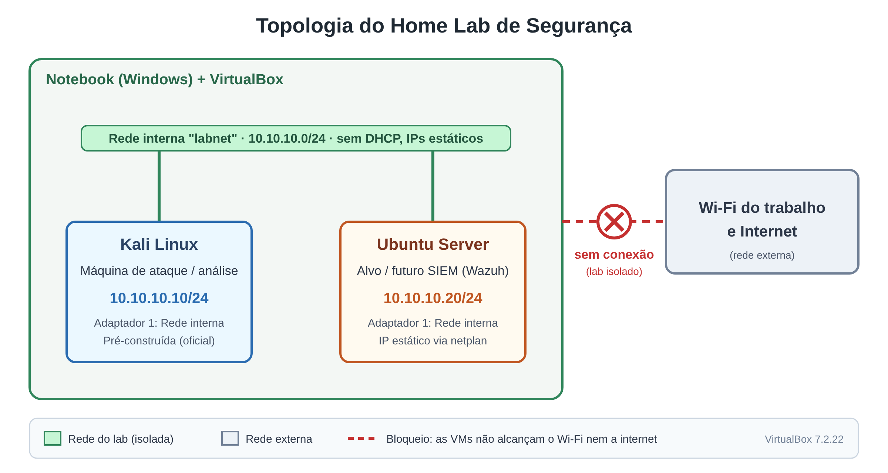

# home-lab-seguranca
Laboratório de segurança isolado com Kali Linux e Ubuntu Server no VirtualBox

# Home Lab de Segurança

> Escreva aqui 1 ou 2 frases: o que é este projeto e o que você aprendeu. Exemplo: "Laboratório isolado com Kali Linux e Ubuntu Server no VirtualBox, para praticar redes, Linux e segurança com segurança."

## 1. Objetivo

> 2 a 3 frases, com as suas palavras. Por que você montou este lab? O que queria aprender? Por que o isolamento era importante?

## 2. Arquitetura

> Insira o diagrama (draw.io) em `docs/topologia.png` e explique em poucas linhas.

| VM | Sistema | Função | IP | Rede |
|---|---|---|---|---|
| (preencher) | Kali Linux | Máquina de ataque / análise | 10.10.10.10/24 | Rede interna `labnet` |
| `ubuntuVM` | Ubuntu Server | Alvo e futuro servidor de SIEM | 10.10.10.20/24 | Rede interna `labnet` |

> Escreva uma linha explicando que o lab **não tem acesso à internet nem à rede externa**.

## 3. Ambiente

> Preencha com os dados reais.

- **Hospedeiro:** (SO do notebook, RAM, CPU)
- **Hypervisor:** VirtualBox (versão: ___)
- **Kali Linux:** versão ___, imagem pré-construída oficial
- **Ubuntu Server:** versão ___, instalado a partir da ISO oficial
- **Recursos por VM:** RAM ___ / CPUs ___ / Disco ___

## 4. Decisões de projeto

> A seção mais importante. Para cada decisão, escreva **o que escolhi, por quê e o que descartei**.

- **Rede interna (e não NAT ou Bridge):** (por quê?)
- **IP estático (e não DHCP):** (por quê?)
- **Ubuntu Server (e não Desktop):** (por quê?)
- **Outros cuidados de isolamento** (área de transferência, pastas compartilhadas, USB): (o que fiz?)

## 5. Como foi configurado

> Resuma os passos principais, com as suas palavras. Não precisa listar todos os cliques.

1. Download e verificação das imagens (hash SHA256).
2. Criação das VMs e configuração da rede interna `labnet`.
3. IP estático no Ubuntu Server com netplan (ver [`configs/99-lab.yaml`](configs/99-lab.yaml)).
4. IP estático no Kali com `nmtui`.

## 6. Validação

> Cole os prints em `imagens/` e referencie aqui. Cada print precisa de uma legenda dizendo o que prova.

| Teste | Resultado esperado | Evidência |
|---|---|---|
| `ip a` no Ubuntu | IP 10.10.10.20/24 | `imagens/ip-ubuntu.png` |
| `ip a` no Kali | IP 10.10.10.10/24 | `imagens/ip-kali.png` |
| Ping Kali → Ubuntu | Responde | `imagens/ping-kali-ubuntu.png` |
| Ping Ubuntu → Kali | Responde | `imagens/ping-ubuntu-kali.png` |
| Ping para `8.8.8.8` | **Falha** (prova o isolamento) | `imagens/ping-internet-falha.png` |

## 7. Problemas e soluções

Veja o arquivo completo em [`docs/problemas-e-solucoes.md`](docs/problemas-e-solucoes.md).

## 8. Próximos passos

- [ ] Scan com `nmap` do Kali contra o Ubuntu, interpretando as portas abertas
- [ ] SIEM com Wazuh (agente no Kali)
- [ ] Simulação de incidente e relatório
- [ ] Honeypot (Cowrie) em ambiente isolado

## 9. Aviso

Todos os testes deste projeto foram feitos apenas em ambiente próprio, virtual e isolado. Senhas usadas são exclusivas do laboratório e não são divulgadas aqui.
